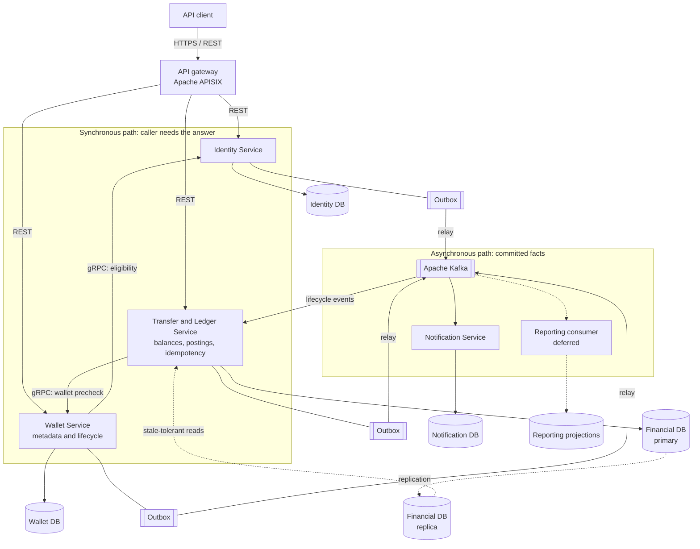

# VaultPay: Initial System Design Proposal

| Document field | Value |
| --- | --- |
| Status | Draft — proposed for review; no approval recorded |
| Author / accountable owner | To be assigned |
| Reviewers | To be assigned: backend, database, security, and operations perspectives |
| Last updated | 29 October 2026 |
| Decision requested | Agree on initial scope, financial guarantees, architecture boundaries, and validation targets |
| Supporting detail | [Requirements and capacity estimates](REQUIREMENTS.md) |
| Follow-up design | [Low-level design](LLD.md), to be written after the main decisions are resolved |

## 1. Summary

VaultPay will let a registered user hold simulated funds, transfer them to another user, inspect transaction history, receive outcome notifications, and view financial summaries. Its engineering purpose is to demonstrate that these operations remain correct under concurrent requests, retries, process failures, and disrupted communication. No real money or external settlement is involved.

This proposal keeps the financial commit boundary small: wallet balances, transfer records, and monetary postings share one transactional source of truth. Notification delivery and reporting run asynchronously. Stateless API instances and background workers can scale independently, while the initial financial store remains unsharded.

When an operation cannot safely read or commit authoritative financial state, VaultPay will make that operation unavailable rather than approve a potentially conflicting payment. The initial workload does not justify distributing the debit and credit across independently owned databases. We can study distributed delivery and recovery without introducing a distributed transaction into every payment.

Reviewers are asked to challenge the proposed boundaries, failure behavior, assumptions, and evidence needed before release. All sizing numbers and service objectives below are provisional; none are measurements or existing production guarantees.

## 2. Problem and Intended Outcomes

A transfer can fail in ways that a successful API demonstration will not reveal. Two requests can spend the same balance. A client can retry after a response is lost. A process can crash after committing a transfer but before publishing its notification. A failover can expose an older copy of financial state.

VaultPay must make these cases understandable and testable. A sender should be able to distinguish a rejection from an uncertain outcome and resolve that uncertainty without transferring twice. An operator should be able to trace the operation, explain every balance change, and recover delayed work.

The primary users exercise a simulated wallet through APIs or a minimal client. Operators need restricted funding, reconciliation, and diagnostic capabilities. The project is also an engineering learning platform; architectural complexity must have a stated learning objective or operational benefit.

Success means that the user journeys work, the financial invariants survive the failure scenarios in Section 10, and the system meets the agreed workload and latency targets in a reproducible environment. Traffic volume alone is not a success criterion.

## 3. Goals and Non-Goals

### Goals

- Support registration, login/logout, one wallet per user, controlled simulated funding, internal transfers, transaction lookup/history, notifications, and period-based summaries.
- Prevent overspending, duplicate monetary effects, partial completed transfers, and unexplained balance changes.
- Demonstrate asynchronous communication, replicated storage, fault recovery, observability, and horizontal application scaling.
- Provide a documented operational model and evidence that the design behaves as claimed.

### Non-goals for the initial release

Real funds, banking/card integrations, external settlement, production KYC/AML processes, foreign exchange, multiple currencies, merchant checkout, recurring payments, lending, cryptocurrency, and formal chargebacks are excluded. A polished customer application and multi-region active-active financial writes are also excluded. Compensating corrections needed to preserve financial records remain in scope.

Sharding and separate databases for the two sides of a transfer are deferred until measurements or a deliberate later experiment justify them. They are not prerequisites for demonstrating a distributed backend.

## 4. Requirements and Acceptance Criteria

### Functional contract

| Journey | Required outcome |
| --- | --- |
| Register and authenticate | A unique identity receives one wallet. Protected requests enforce ownership, session expiry, and revocation. |
| Fund a wallet | An explicitly authorized test-funding action increases the balance once and records its origin. Ordinary users cannot mint funds without this authorization. |
| Transfer funds | A positive, supported-currency amount moves between distinct active wallets when sufficient spendable funds exist. Debit and credit commit together. |
| Retry or query a transfer | A caller-scoped idempotency key identifies the original operation. The same payload returns its outcome; a changed payload is rejected. A timeout is resolved using the original key. |
| Inspect activity | Users can query authoritative transaction status and paginated history filtered by period, type, and status within their own accounts. |
| Receive notifications | Committed outcomes eventually produce notifications through one initial channel. Delivery retries cannot change the transfer outcome. |
| Review finances | Users receive period summaries; authorized operators inspect aggregate outcomes, outstanding work, and reconciliation discrepancies. |

### Financial invariants

1. A wallet's spendable balance never becomes negative, including under concurrent requests.
2. A completed internal transfer conserves funds: the sender debit equals the recipient credit.
3. One accepted operation has at most one monetary effect, regardless of request or message retries.
4. Every balance change is explained by durable monetary postings. Completed postings are immutable; corrections use linked compensating entries.
5. A completed response refers to a durable commit. Authoritative reads after that completion reflect it or a later committed state.
6. An acknowledged monetary commit survives the supported single-node or single-failure-domain loss. Regional disaster recovery has a separate loss bound.

Use integer minor units or exact fixed-precision values. Funding is an explicit source of simulated funds and must be distinguishable from internal transfers during reconciliation.

### Quality objectives

| Area | Proposed acceptance target | Evidence required |
| --- | --- | --- |
| Correctness | No financial invariant violations in the agreed scenarios | Concurrent and failure-injection tests plus reconciliation results |
| Performance | 50 sustained API RPS at an 80/20 read/write mix; p95 reads ≤200 ms and monetary writes ≤500 ms under healthy conditions | Load report with workload, duration, data size, hardware, latency distribution, and error rates |
| Availability | 99.9% monthly for eligible core API requests | Endpoint-level SLI and external probes; a short load test cannot establish a monthly SLO |
| Single-failure recovery | RTO ≤5 minutes; zero lost acknowledged monetary commits | Node/failure-domain loss and safe-promotion exercise |
| Regional recovery | RTO ≤24 hours; RPO ≤15 minutes, subject to backup/log-shipping design | Restore from independently stored backups and recovery logs |
| Security | Ownership checks, restricted funding, revocable sessions, secure credential storage, transport encryption, rate limits, and redacted telemetry | Security review and authorization tests |
| Operability | Traceable transactions, measurable backlog, health/readiness signals, alerts, and recovery procedures | Dashboard and runbook walkthrough with a failure exercise |

The [supporting requirements](REQUIREMENTS.md) retain the detailed functional and non-functional requirements. This proposal explains how we intend to satisfy them and where agreement is still needed.

## 5. Workload and Capacity Model

There is no observed workload yet. These hypotheses bound the first design and need review before becoming capacity commitments. Units are decimal KB/GB; the model assumes constant traffic for 365 days.

| Input | Assumption | Design consequence |
| --- | --- | --- |
| Registered users / daily active users | 100,000 / 10,000 | Start with one logical financial database; validate with representative data. |
| Requests per active user per day | 20 | 200,000 requests/day, approximately 2.31 average RPS. |
| Peak multiplier / read-write mix | 10× / 80:20 | Approximately 23.15 peak RPS, including 4.63 write RPS. A 50 RPS test leaves initial headroom. |
| Transfers / funding operations | 20,000 / 2,000 per day | 22,000 monetary operations/day, included in total API traffic. |
| Raw data per monetary operation | 2 KB across associated persistent records | Approximately 16.06 GB/year for 8.03 million operations. Validate against the schema. |
| User and wallet data | 2 KB per registered user | Approximately 0.20 GB. |
| Index/overhead multiplier / headroom | 2× / 30% | `(16.06 + 0.20) × 2 × 1.30 ≈ 42.28 GB` per database copy. |
| Full database copies | Three in one region | Approximately 126.83 GB across copies; budget at least 50 GB/node for baseline data, plus disk for logs and maintenance. |

Replicas do not increase logical storage capacity. Backups, recovery logs, message retention, reporting data, and telemetry need separate budgets. Seven 50 GB full backups consume approximately 350 GB before compression and recovery logs. One 1 KB access-log record per request adds approximately 6 GB per 30 days, excluding other telemetry.

This model does not prove database throughput or justify a machine size. A heavily used wallet can serialize writes even when aggregate traffic is low; benchmark that case separately. Revisit the design when measured lock waits, write throughput, recovery time, or growth exceed the tested envelope. Hosting choice, instance sizes, and monthly cost require a concrete deployment configuration and remain open.

## 6. Proposed Design

### Components and ownership

**Reading the diagram.** Solid arrows into services are request/response calls: REST from the client through the gateway, and gRPC between services only where the caller cannot proceed without the answer. The monetary decision (funds check, debit, credit, idempotency record, outbox row) happens inside one Financial DB transaction in Transfer and Ledger. Everything after the commit travels as an event: each service writes to its own outbox in the same transaction as its state change, a relay publishes to Kafka at-least-once, and consumers deduplicate. Notification and reporting failures never affect a committed transfer.

**Rule of thumb.** Use gRPC when the caller needs the result to finish its own work; use Kafka when something has happened and other services may react in their own time. Never use an event as a request/response substitute, and never put notification or reporting calls on the financial commit path.

Each service privately owns its database, and only Transfer and Ledger updates balances or postings. The diagram follows the microservices proposal in [MICROSERVICES.md](MICROSERVICES.md); whether Identity and Wallet become separate deployables or start as one modular API remains open decision D1, and the same ownership boundaries apply either way. Background relays and consumers run as separate processes. The Financial DB replica serves only history and reporting queries that tolerate staleness; authoritative balance and transfer-status reads stay on the primary.

The primary stores identities, wallets, transfer records, monetary postings, idempotency records, and an outbox of committed events. Reporting projections and caches are rebuildable derivatives. They cannot authorize spending or resolve an uncertain monetary commit.

Database replication is part of the durability boundary. The selected deployment must define commit acknowledgement, safe promotion, and fencing of the old writer. Three copies alone do not prove these properties. The concrete database and HA configuration require a follow-up decision before implementing production-like failover.

### Transfer lifecycle

The API authenticates the sender, validates the request, and checks a durable, caller-scoped idempotency record. Inside one database transaction, it serializes access to the affected wallets, checks funds, writes the debit and credit, updates balances, records the outcome, and creates an outbox event. The idempotency outcome commits with the monetary changes.

The proposed concurrency mechanism is database row locking with deterministic wallet-lock order. Constraints remain a second line of defense. Deadlock or serialization retries must be bounded and reuse the same key; the isolation level and queries belong in the LLD.

Before commit, a rejected operation has no financial effect. After commit, losing the response does not undo the transfer. The client queries authoritative status or retries the same key. A transient processing state must not be interpreted as completion; uncommitted work must not leave durable partial debits. The LLD will specify state transitions, rejection persistence, and concurrent duplicate-request handling.

An outbox relay publishes committed events with at-least-once delivery. Consumers deduplicate by event identity and record progress durably. If publication succeeds and acknowledgement is lost, replay is expected. User-visible notification deduplication requires an idempotent destination or a durable notification record; exactly-once external email delivery cannot be assumed.

### Consistency and partition behavior

The wallet core favors consistency during partitions. A node unable to reach authoritative state or satisfy the safe commit policy rejects or delays financial operations. It must not independently spend a stale balance. A healthy side may continue only if it retains legitimate write authority and the required durable replicas.

History and reports may lag and expose their freshness. Authoritative balance and transfer-status requests do not silently fall back to stale replicas. This applies the [CAP consistency/availability tradeoff](https://www.comp.nus.edu.sg/~gilbert/pubs/BrewersConjecture-SigAct.pdf) to specific operations. CAP consistency means linearizability; atomicity and transaction isolation are additional financial requirements, not guarantees established simply by calling the database ACID.

### Database review concerns

Review entities and access patterns before finalizing the schema: lookup by identity, wallet lookup by owner, transfer lookup by ID/key, history by wallet and time, pending outbox scans, and reconciliation by posting/transaction. Unique constraints must enforce identity, wallet ownership, and idempotency boundaries.

The LLD must include query/index plans, transaction boundaries, lock order, monetary precision/limits, event evolution, idempotency retention, migrations, and reconciliation queries. History pages and pending-work scans must remain bounded as data grows. The one-year sizing horizon is not permission to delete financial history; archival and deletion policy remain open.

## 7. Alternatives and Tradeoffs

| Alternative | Benefit | Cost or risk | Proposed disposition |
| --- | --- | --- | --- |
| Synchronous notifications and reports | Simple request flow | Downstream failures block payments; commit-to-notification failures remain ambiguous. | Reject; use an outbox and asynchronous consumers. |
| Independently writable wallet stores with eventual reconciliation | More write availability on isolated nodes | Conflicting spending decisions violate the balance contract. A recipient may spend credit before compensation. | Reject for the initial financial core. |
| Separate debit and credit databases | Independent ownership and scaling | Requires reservations, distributed coordination, or compensation and more recovery logic. | Defer until justified by measurements or a separately scoped experiment. |
| Inline background tasks in the API process | Fewer moving parts | Restarts and slow work couple API health to delivery. | Keep logical modules together initially, but execute durable background work in separate workers. |
| Sharded or multi-region financial writes from day one | Larger scaling envelope | More complex transactions, failover, and operations without demonstrated demand. | Defer; establish the single-store limit first. |

## 8. Reliability, Security, and Operations

The proposed availability SLI is the fraction of eligible API requests receiving a correct response within two seconds. Expected business rejections count as correct; server errors, timeouts, and unexpected throttling within supported load count as failures. Malformed, unauthenticated, and over-limit requests are excluded. Track financial endpoints separately and use external probes during idle periods. Planned maintenance and partition-related failures consume the error budget.

At 200,000 eligible requests/day, a 30-day month contains six million requests; 99.9% permits 6,000 bad outcomes. For a separate time-based comparison, 99.9% allows 43.2 minutes/month or 8.76 hours/year. Request and time budgets differ under uneven traffic. A five-minute full outage consumes approximately 11.6% of the monthly time budget.

Four independent required dependencies at 99.9% each yield `0.999^4 ≈ 99.6006%`. Shared failures make this simplified estimate less reliable. Keep notification/reporting dependencies out of the commit path, measure service availability, and exercise failover rather than inferring it from replica count.

Authorization applies to every resource access, including projections. Funding and operator endpoints need explicit privileges. Securely hash passwords; expire and revoke sessions; encrypt deployed network traffic; restrict database privileges; keep secrets outside source control. Exclude credentials and unnecessary personal data from telemetry.

Correlate requests, transfers, and events in logs and traces. Monitor latency/errors, lock waits, replication health, outbox age, consumer lag, duplicate suppression, and reconciliation discrepancies. A discrepancy requires investigation, not an automatic balance overwrite. Provide procedures for uncertain outcomes, delayed delivery, safe replay, database failover, restore, and stopping monetary writes.

Regional restore has a proposed 15-minute RPO and can lose recent acknowledged records beyond the single-failure guarantee. Accept that risk explicitly or strengthen the durability design. Regional recovery can exceed the monthly SLO; the 24-hour recovery target does not exempt the outage from measurement.

## 9. Risks and Open Decisions

| ID | Issue | Next action | Resolution needed |
| --- | --- | --- | --- |
| D1 | Are a modular API and independent workers sufficient for the learning goals? | Review distribution boundaries; give any additional service a concrete purpose. | Before committing service boundaries |
| D2 | Which database/HA configuration provides safe failover and durability? | Compare acknowledgement, promotion, fencing, and recovery behavior. | Before HA implementation |
| D3 | Workload and storage estimates are unmeasured. | Benchmark the schema and queries, including contention and backlog replay. | Before accepting capacity claims |
| D4 | Idempotency retention and retry windows are undefined. | Prevent expired keys from silently duplicating a transfer. | Before API/schema review |
| D5 | Notification channel and delivery guarantee are undefined. | Select a channel and document destination deduplication limits. | Before notification implementation |
| D6 | Regional loss tolerance may conflict with expectations. | Accept the loss window or strengthen cross-region protection and revise cost/latency. | Before resilience claims |
| D7 | Hosting budget, instance sizes, and retention policy are undefined. | Produce a deployment budget and online/archive retention proposal. | Before hosted rollout |

Accountable owners and reviewers have not been assigned. Record them during review rather than treating these entries as completed decisions.

## 10. Validation and Delivery Plan

| Stage | Deliverable | Exit evidence |
| --- | --- | --- |
| Design review | Resolve boundaries, invariants, D1, and required investigations. | Recorded decisions and named owners for unresolved items |
| Financial core | Identity, wallets, funding, transfers, status, and history | Concurrent spending, duplicate keys, payload conflicts, authorization, and reconciliation checks |
| Asynchronous processing | Relay, notifications, reporting, and replay controls | Crash between commit/publish; duplicate/out-of-order events; consumer outage/recovery |
| Resilience and capacity | HA configuration, telemetry, runbooks, backups, and load tests | Safe failover, partition handling, reconciled restore, 50 RPS run, and hot-wallet report |
| Controlled rollout | Test identities and simulated funds; gradual traffic and failure exercises | Reviewed evidence, monitored error budget, no unresolved correctness blockers |

Also test lost responses after commit, crashes before commit, restarts during a transfer, replica lag during promotion, and exhausted retries. Verify financial invariants after each scenario. Report p50/p95/p99, throughput, error rate, contention, and the exact environment.

Rollback must preserve committed financial records. Stop new writes if correctness is uncertain, reconcile authoritative data, and roll versions back only when schema and event compatibility allow it. Replaying events must never replay monetary effects. Prefer backward-compatible migrations and document forward recovery for irreversible changes.

## 11. Review Process and Decision Record

For VaultPay, circulate the draft before review so readers can comment on specific claims. Review the problem, scope, and invariants first, then examine transfer behavior, failures, database design, and alternatives. Resolve factual questions through evidence or a scoped experiment. Record disagreements and their disposition.

Use backend, database, security, and operations perspectives even if one person fills several roles. Give each blocking comment an owner and resolution condition. After revision, record acceptance, acceptance with explicit conditions, or the need for another review. This is a proposed project workflow, not a claim about any company's exact internal approval process.

| Decision | Current state | Rationale | Approver and date |
| --- | --- | --- | --- |
| One transactional financial boundary | Proposed | Keeps debit, credit, idempotency, and event intent atomic | Not recorded |
| Consistency over partition-time monetary availability | Proposed | Prevents conflicting spending | Not recorded |
| Asynchronous notifications and reporting | Proposed | Isolates commits from downstream outages | Not recorded |
| Workload, availability, and recovery targets | Proposed | Need measurement and review | Not recorded |

Update this record when decisions are made. Significant changes to consistency, ownership, or failure guarantees require a design revision; implementation details can evolve in the LLD.

## 12. Public References and Document Approach

This document adapts published engineering practices; it does not reproduce a Rubrik, Amazon, or Google internal template.

- [Software Engineering at Google: Design Docs](https://abseil.io/resources/swe-book/html/ch10.html#design_docs) describes collaborative design review before major implementation, including security, storage, and privacy concerns.
- [AWS: The Secrets to Product Management](https://d1.awsstatic.com/executive-insights/en_US/product-management-ebook.pdf) explains Working Backwards and PR/FAQ for establishing customer value. A PR/FAQ is product framing and does not replace technical design review.
- [Rubrik: Engineering Robustness in a Large Cloud SQL Fleet](https://www.rubrik.com/content/dam/rubrik/en/resources/white-paper/rwp-insights-from-engineering-robustness-in-rubriks-large-cloud-sql-fleet.pdf) describes an engineering-wide database-design section and early review of tables and queries. It does not publish a complete company-wide design-review template.
