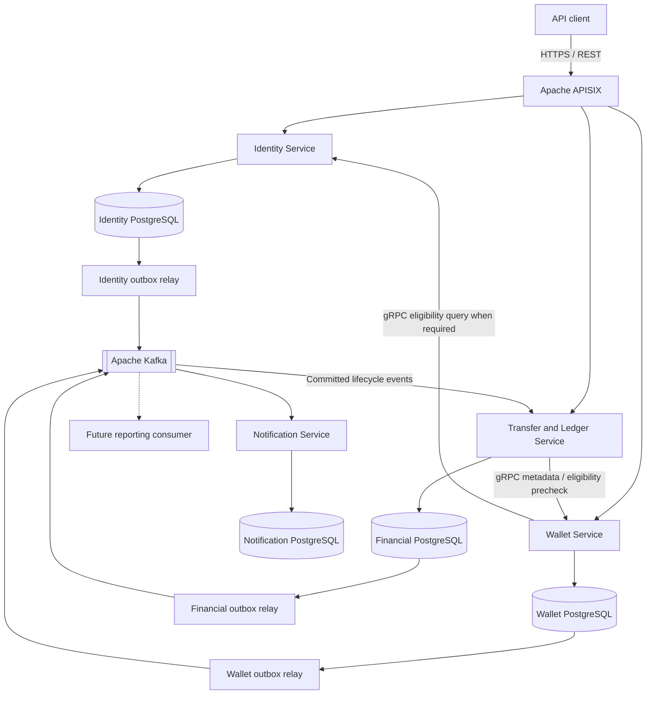

# VaultPay — Microservices Architecture and Design Decisions

| Document field | Value |
| --- | --- |
| Version / status | 1.0 — proposed; no architecture approval recorded |
| Author / accountable owner | [Likhith Raju P](https://github.com/likhithrajuuu) |
| Reviewers | To be assigned: backend, database, security, and operations perspectives |
| Last updated | 29 October 2026 |
| Decision requested | Review service ownership, communication contracts, financial correctness, replication policy, and implementation sequence |
| Related documents | [HLD](HLD.md), [requirements and capacity assumptions](REQUIREMENTS.md), [LLD](LLD.md) |

## 1. Purpose and Architectural Position

VaultPay is a distributed wallet and payment processing platform built with simulated funds. Users authenticate, create wallets, receive controlled test funding, transfer funds, inspect activity, and receive notifications. Financial reporting and reconciliation provide explanations of the resulting monetary state. Real banking integrations, real funds, and external settlement are outside the initial scope.

The architecture deliberately uses independently deployable services to study distributed communication, data ownership, concurrency, replication, recovery, and observability. At the currently assumed scale, a modular monolith would also be reasonable and would cost less to operate. Microservices are selected for the project's engineering objectives, rather than as a demonstrated throughput requirement.

The proposed stack is Java 21 and Spring Boot, Gradle Kotlin DSL, Apache APISIX for external routing, gRPC for necessary synchronous internal calls, Kafka for asynchronous integration, and PostgreSQL for authoritative persistence. Redis and Kubernetes are later experiments, not initial prerequisites.

### 1.1 Proposal versus implementation

The repository currently contains an Identity Service Spring Boot scaffold with security, OAuth2 client, and JWT resource-server dependencies. Provider sign-in, application token issuance, persistence, APISIX, gRPC, Kafka, and the other services have not been implemented by this scaffold. A dependency on an authentication library is not a completed authentication system.

This document develops the supplied microservices design. The existing HLD also contains a smaller modular-API proposal. The proposals share one important financial boundary, but differ on deployment boundaries: this document proposes separate Identity and Wallet services. Record that choice during review and reconcile the HLD before calling either architecture approved. Only this document is changed as part of this write-up.

The earlier capacity model assumes three database copies; the supplied replication experiment uses one primary and one replica. These are different scenarios. The two-node experiment below must not inherit the earlier zero-loss failover claims or three-copy storage estimate without validation.

## 2. Decision Summary

Every decision below is proposed. Product choices are separated from correctness obligations: deployment topology can evolve, but changes must continue to satisfy the financial invariants.

| ID | Decision | Why it is proposed | Main consequence |
| --- | --- | --- | --- |
| ADR-01 | Separate Identity, Wallet, Transfer & Ledger, and Notification services | Provides distinct business ownership and realistic deployment/failure experiments | More network, contract, and operational complexity than a monolith |
| ADR-02 | Transfer & Ledger exclusively owns balances and monetary postings | Debit and credit must share one authoritative transaction boundary | Wallet is a metadata/lifecycle service, not a second balance authority |
| ADR-03 | Each service privately owns its persistence | Enables schema evolution and prevents hidden cross-service coupling | Cross-service queries use contracts or derived projections |
| ADR-04 | APISIX exposes REST APIs; services still enforce authorization | Centralizes edge concerns while preserving resource ownership checks | Gateway health and configuration are operational dependencies |
| ADR-05 | Use gRPC only where the caller needs an immediate answer | Gives typed internal contracts and explicit request/response semantics | Deadlines, identity propagation, compatibility, and retries need design |
| ADR-06 | Use Kafka for committed business events | Decouples producers from notification/reporting availability and allows replay | Delivery, ordering, retention, and consumer recovery become responsibilities |
| ADR-07 | Publish through an outbox; consumers tolerate duplicates | Avoids an unsafe database/Kafka dual write | At-least-once processing needs durable deduplication |
| ADR-08 | Preserve financial consistency during partitions | Prevents conflicting spending and false completion claims | Affected monetary operations may become unavailable |
| ADR-09 | Introduce PostgreSQL replication as a measured experiment | Makes lag, routing, failover, and recovery observable | Asynchronous replication alone cannot promise zero data loss |
| ADR-10 | Standardize Java services on the root Gradle Kotlin build | Keeps toolchains and dependency management consistent | Independent deployments still require explicit CI and compatibility checks |

## 3. Service Boundaries and Data Ownership

### 3.1 Identity Service

**Responsibility.** Own user identities, supported authentication mechanisms, Google/Apple OAuth2/OIDC integration, and the eventual VaultPay access-token/session policy. Provider credentials, signing material, session/refresh-token state, and account eligibility belong here.

**Why separate it.** Authentication has different security, credential-management, and provider-integration concerns from financial processing. Separating it allows those changes to be deployed without making Identity a writer of financial data.

**Contracts.** Expose public authentication APIs and provider callbacks through the gateway. Publish durable identity lifecycle/security events when downstream work is needed. Provide a narrow internal eligibility query if Wallet creation requires a current account check. Do not require an Identity RPC merely to validate every JWT signature.

**Security boundary.** A token's verified subject identifies the caller; a user ID supplied in a request body does not establish ownership. Resource services validate the expected issuer, audience, signature algorithm, expiry, and other required claims. Key rotation requires bounded key caching and handling for unknown keys. Google/Apple identities must be mapped to a VaultPay identity using verified provider identifiers; matching email addresses alone is not a safe account-linking rule.

**Open contract.** Local JWT verification does not provide immediate account-disable or token-revocation propagation. Define access-token lifetime, refresh revocation, and any immediate-block mechanism before promising immediate revocation. Provider ID tokens are not automatically VaultPay API access tokens.

### 3.2 Wallet Service

**Responsibility.** Own wallet identifiers, user ownership, currency metadata, lifecycle, and requested operational status. Enforce the initial one-wallet-per-user rule within its own database. Wallet ownership should be immutable in the first release; ownership transfer would require a separate protocol.

**Why separate it.** Wallet provisioning and lifecycle have different workflows from moving funds. This boundary provides a useful service-ownership experiment while keeping balance updates elsewhere.

**Contracts.** Expose wallet creation and metadata APIs, answer narrow eligibility queries, and publish versioned lifecycle events. Wallet never directly reads or writes financial tables. A balance shown with wallet metadata is fetched from Transfer & Ledger through an explicit contract, or clearly identified as a non-authoritative projection.

**Provisioning consequence.** A metadata record alone does not make a wallet ready to receive money. Transfer & Ledger must have an initialized financial account before an effective active state is exposed. Provisioning failures leave a retryable pending state; they must not create duplicate wallets or accounts. The activation protocol is a review item in Section 13.

### 3.3 Transfer & Ledger Service

**Responsibility.** Own financial accounts, authoritative balances, funding operations, transfers, postings, monetary idempotency, authoritative transaction status, and the financial outbox. Both sides of every initial internal transfer live in this service's PostgreSQL transaction boundary.

**Why keep transfers and ledger together.** Splitting debit, credit, and ledger into separate databases would require distributed coordination or compensation for every transfer. Keeping them together allows the first release to demonstrate concurrency and reliable event integration without making financial atomicity depend on several services completing together.

**Contracts.** Expose funding, transfer submission, balance, transaction-status, and financial-history APIs. Test funding requires explicit authorization and recorded origin. Publish committed outcomes for downstream consumers. A successful API response means a committed financial outcome, not merely an accepted Kafka message.

**Accounting model.** Represent amounts exactly and maintain immutable postings. Each completed internal transfer has equal debit and credit totals. Simulated funding must have an explicit source/system account or equivalent balancing treatment so newly introduced funds remain explainable. If balances are stored as materialized values, update them with postings in the same transaction and reconcile them against those postings.

**Lifecycle boundary.** The financial transaction must also enforce an effective spending gate owned locally by this service. A remote Wallet status query is a precheck, not an atomic guarantee that a freeze cannot race with a transfer. Section 7 explains the required protocol decision.

### 3.4 Notification Service

**Responsibility.** Consume committed business/security events, create notification work, and track delivery attempts and outcomes. Own templates, delivery preferences where applicable, deduplication records, and delivery status. Choose one initial delivery channel before implementation.

**Why separate it.** A slow or unavailable destination should delay delivery without reversing a committed transfer or exhausting the transfer service's request threads.

**Contracts.** Consume only the events it needs using its own consumer group. A delivery result is notification state, never authority over a transfer. Do not add a public notification-management API until there is a user requirement.

**Delivery limit.** A durable notification record can be deduplicated, but an external send may succeed before the worker records success. Exactly-once external delivery requires destination support; otherwise document the possibility of duplicate messages and ensure retries never duplicate financial effects.

### 3.5 Deferred services

| Candidate | Introduce when | Responsibility that must exist beforehand |
| --- | --- | --- |
| Reporting | Independent projections or report workloads justify a deployable | Initial user financial summaries/history remain part of the product scope |
| Reconciliation | Scheduled verification needs independent scaling or operations | Basic ledger/balance reconciliation is required from the financial-core phase |
| Audit collection | Centralized review/retention justifies another consumer | Every service records its own security and business audit events from the start |
| Fraud/risk | Explicit risk rules and synchronous/asynchronous behavior are defined | Authorization, validation, and abuse controls already apply |
| Payment integration | A separately scoped simulation requires external-provider workflows | No real settlement or banking integration is implied |

Deferring a service does not defer an essential correctness or security capability. Initial summaries and reconciliation may run within Transfer & Ledger until extraction has a clear benefit.

## 4. System Topology

Each outbox relay reads the owning service's outbox; there is no shared outbox database and no relay with unrestricted access to every service's private tables. The lifecycle-event path supports provisioning and synchronization; it does not, by itself, provide an immediate wallet-freeze guarantee.

Gateway routes and internal RPCs are directional contracts, not permission for every service to call every other service. Keep call chains shallow and avoid synchronous dependency cycles. Discovery and load balancing will use the selected deployment environment; a dedicated service registry has not been selected.

## 5. Edge Routing, Authentication, and Trust

APISIX is selected as a centralized ingress for HTTPS termination, route configuration, request limits, correlation propagation, and access telemetry. Its authentication plugins are candidates for edge token checks, but the exact plugin and trust configuration remain to be selected. The Identity Service remains responsible for the chosen Google/Apple login flow; gateway capability does not imply that VaultPay already operates an OIDC provider.

Every resource service enforces its own authorization. A gateway-validated token does not authorize access to another user's wallet. Strip or overwrite client-supplied identity headers and do not trust an unsigned `user-id` header simply because it arrived through the gateway. Internal endpoints require authenticated workload identity and authorization; mTLS is a planned option, not an existing deployment guarantee.

External REST APIs give clients HTTP-compatible contracts while leaving internal contracts free to evolve separately. Keep the gateway focused on transport and edge policy. Transfer orchestration, monetary retries, and database decisions belong in the owning service. Gateway retries of monetary writes must preserve the same idempotency identity and cannot turn an unknown outcome into a new operation.

See the [APISIX authentication overview](https://apisix.apache.org/learning-center/api-gateway-authentication/) for available mechanisms; actual key discovery, claim validation, and rotation behavior must be tested with the selected plugin.

## 6. Synchronous Communication: gRPC

gRPC is proposed for internal requests whose caller needs an immediate answer, such as an account eligibility query or a wallet metadata precheck. Protocol Buffers provide an explicit typed contract and generated clients. These are contract-management benefits; gRPC is not assumed to be faster than REST for VaultPay without an equivalent-workload benchmark.

| Interaction | Reason | Failure policy |
| --- | --- | --- |
| Wallet → Identity eligibility | Establish whether wallet provisioning is allowed | Leave creation pending or reject as retryable; never assume eligibility on timeout |
| Transfer → Wallet precheck | Obtain required current metadata before financial processing | Do not use an unavailable or stale answer as permission; resolve an existing transfer before retrying |
| Service-local JWT verification | Authenticate ordinary requests without an Identity call | Reject unverifiable tokens; define cache and rotation behavior |
| Committed outcome → Notification | No immediate answer is needed | Use Kafka rather than an RPC on the financial commit path |

Every RPC requires a deadline derived from the caller's remaining request budget. Propagate trace context and an authenticated caller identity. Map business rejections separately from transport unavailability so clients can decide whether to correct the request, query status, or retry.

Retry only explicitly retryable operations, with bounded attempts, backoff, jitter, and the original idempotency key for writes. A deadline expiring does not prove the server made no change. Circuit breakers and concurrency limits protect callers, but cannot invent a correct financial result when the dependency is unavailable. See [gRPC deadlines](https://grpc.io/docs/guides/deadlines/) and [retry behavior](https://grpc.io/docs/guides/retry/).

Evolve protobuf contracts compatibly: add fields rather than reinterpreting existing ones, preserve field numbers, reserve removed fields, and test old/new client combinations. Deployment independence depends on this compatibility; having separate containers does not establish it.

## 7. Financial Consistency and Lifecycle Coordination

### 7.1 Financial invariants

1. Spendable balances never become negative under concurrent requests.
2. A completed internal transfer debits and credits the same amount within one transaction.
3. A caller's accepted idempotent operation changes money at most once.
4. Every balance change has durable, immutable postings and an auditable origin.
5. A completed response refers to a durable commit; unknown outcomes remain queryable.
6. No other service directly modifies financial state.

The proposed implementation uses PostgreSQL transactions, deterministic wallet/account lock order, unique idempotency constraints, and database checks. The LLD must choose isolation level, locking queries, precision/limits, and retry rules. Application checks outside a transaction are insufficient to prevent concurrent overspending.

### 7.2 Transfer flow

1. Authenticate and authorize the caller; validate amount, currency, recipient, and idempotency key.
2. Resolve any existing idempotency record using the caller and operation scope. Reject key reuse with a different canonical payload. Concurrent identical requests must converge on one operation.
3. Obtain any necessary external metadata before opening the financial transaction. Avoid holding account locks while waiting for a network call.
4. In one financial transaction, check the locally enforced execution gates, lock both accounts in a stable order, verify funds, write postings, update materialized balances, persist the outcome/idempotency record, and append an outbox event.
5. Return completed only after commit under the selected durability policy. A crash before commit rolls back the financial changes. A lost response after commit is resolved through authoritative status or the original key.
6. Publish the event asynchronously. Notification or reporting failure never rolls back this committed transfer.

Validation failures, durable business rejections, in-progress requests, and uncertain outcomes need explicit API/state definitions in the LLD. Idempotency retention must match the retry contract; silently forgetting a key can permit a delayed retry to spend again.

### 7.3 Wallet freeze and activation race

Consider a transfer that reads `ACTIVE` from Wallet, followed by Wallet accepting a freeze, followed by the transfer committing. A successful gRPC check did not make the two databases atomic. An asynchronously copied status has the same race and a longer stale window.

The proposed refinement is to distinguish Wallet's **requested lifecycle status** from an **effective financial execution gate** stored and enforced by Transfer & Ledger. Provisioning, freeze, and close commands carry stable identities and monotonic versions; duplicates and stale versions must not undo newer state. Wallet must not acknowledge a freeze as financially effective until the financial owner has durably applied it. Application of that gate and transfers must serialize inside the financial store.

The contract must state what happens to transfers already committed before the gate takes effect, and how an accepted but unacknowledged lifecycle command is queried/retried. During outages, show pending status instead of claiming that a requested freeze is already enforced. A one-time status precheck or an ordinary lifecycle event is not this protocol. Exact commands, acknowledgement flow, and activation ordering remain a blocking design decision before lifecycle enforcement is implemented.

### 7.4 Partition policy

Financial operations favor consistency when communication failures prevent safe reads or commits. An isolated node must not approve payments from a stale balance or promote itself without write authority. Reachable nodes may continue only when the configured commit and fencing rules remain satisfied.

This is the consistency/availability tradeoff during a partition, not a choice to assume partitions never happen. A high operational availability objective can coexist with this policy, but partition-related errors still consume the error budget. History/reporting projections may be eventually consistent; authoritative balance and transaction-status endpoints must not silently use them.

## 8. Asynchronous Integration: Kafka and the Outbox

### 8.1 Why Kafka

Kafka provides a retained event log for independent consumers, replay, consumer-group coordination, and partition-based processing experiments. Producers should record facts such as `TransferCompleted`, not delegate ownership of the transfer outcome to Notification. Kafka's operational and schema-management costs are accepted for these learning objectives; it is not the financial ledger or the source of truth for spendable balances.

Topic names, partition counts, broker topology, retention, and schema tooling remain to be selected. Consumer groups belong to logical subscribers: instances of Notification share its group, while Reporting uses another group so both can receive the same events. Within a group, normal partition assignment limits parallelism; adding workers beyond available partitions does not automatically increase throughput.

### 8.2 Reliable publication

The producer commits its business update and outbox row in the same local transaction. A service-owned relay reads committed rows, publishes them, and records acknowledged progress. Publishing can succeed while progress recording fails, so duplicate publication is expected. Database commit followed by a best-effort Kafka send without an outbox leaves a crash window that can lose the event.

If Kafka is unavailable, committed outbox rows accumulate and the financial outcome remains committed. This decoupling is bounded by disk and operational capacity: monitor oldest unpublished age and growth, and apply controlled backpressure before exhaustion. Retention cleanup must not delete unpublished work. Select polling or CDC after comparing operational cost and ordering requirements.

### 8.3 Consumer correctness and ordering

Event envelopes should include a stable event ID, type/schema version, source, aggregate ID and version, occurrence time, and trace/correlation context. Include the minimum personal information needed by the consumer. Schema changes must remain compatible with retained events and replay.

Commit a consumer's deduplication marker and its database effect in one local transaction, then acknowledge/commit Kafka progress. A crash after the database commit but before the offset commit results in replay, which the marker makes harmless. External delivery needs the separate protections described for Notification.

Kafka ordering is scoped to a partition, not to all transfers or topics. Choose keys based on the ordering requirement: a transfer ID can order one transfer's events, but cannot order every change to both participating wallets. Financial correctness comes from the financial database transaction, not from assuming a total Kafka order. Version-aware consumers must handle stale/duplicate lifecycle events and identify gaps where required.

Use bounded retries and an inspectable failed-event path. Moving a poison event aside may break aggregate ordering; document whether later events can proceed or that aggregate must pause. Replays require authorization, an audit trail, and safeguards against re-sending historical notifications. Define how to rebuild a projection if its needed events have expired from retention.

Kafka's exactly-once processing features do not automatically make PostgreSQL effects or external delivery exactly once. This design assumes at-least-once delivery and explicitly handles duplicate effects. See the [Kafka delivery-semantics documentation](https://kafka.apache.org/design/).

## 9. Persistence, Replication, and Recovery

### 9.1 Database per service

Each service owns its PostgreSQL data and migrations. Use separate databases/roles or clearly isolated private schemas for a resource-constrained development deployment. Other services must not query private tables, perform cross-service joins, or share writable entity models. Shared hardware is permitted as a development cost choice, but creates a shared failure and resource-exhaustion domain.

Distributed user journeys are not automatically cross-database ACID transactions. Wallet provisioning needs explicit pending/recovery behavior. Reporting obtains data through owned APIs/events rather than joining Identity, Wallet, and financial tables with privileged credentials. Extracting services later must preserve these ownership contracts.

### 9.2 Primary and replica experiment

Start the replication experiment with one PostgreSQL primary and one standby for a selected service, preferably the financial store. Observe behavior before multiplying that topology across every database. Replication of a shared physical cluster also shares its failure domain; it is not independent per-service HA.

The primary handles writes and authoritative balance, transfer-status, idempotency, authorization-sensitive, and read-after-write queries. Replicas may serve explicitly stale-tolerant history/reporting queries. Do not route all `SELECT` statements to a replica: reads can participate in correctness decisions or require the latest commit.

PostgreSQL streaming replication is asynchronous by default. A primary may acknowledge a commit before a standby has received/replayed it; promoting that standby can lose acknowledged data. Synchronous replication can strengthen durability at the cost of latency and write availability, but requires specific acknowledgement and promotion rules. See [PostgreSQL standby and replication behavior](https://www.postgresql.org/docs/current/warm-standby.html).

An asynchronous lab deployment is therefore a lag/data-loss experiment, not evidence that the earlier zero-loss single-failure requirement has been met. Do not silently weaken that requirement. Before claiming production-like financial failover, select synchronous durability settings, eligible promotion rules, failure detection, and a way to fence the previous writer. With one required synchronous standby, losing it can block commits; increasing replica count alone does not resolve the policy.

### 9.3 Recovery and retention

Measure received/replayed WAL positions, replication delay, connection recovery, and the age of retained WAL. Replication slots can retain WAL when a replica falls behind, so monitor disk and bound the recovery procedure. Replica promotion is one step in failover; clients must reconnect safely, and there must be only one legitimate writer.

Replicas are not backups: accidental deletion and corruption can propagate. Test backups, WAL archiving, point-in-time restore, credential recovery, and post-restore reconciliation. Financial records, idempotency records, outbox history, consumer deduplication, and Kafka offsets may recover to different points; restore procedures must prevent duplicate money movement and identify derived data that needs rebuilding.

State RPO/RTO per tested failure scenario. Earlier documents propose 99.9% availability, five-minute single-failure recovery, and zero lost acknowledged financial commits. These remain review targets, not demonstrated capabilities. For a time-based comparison, 99.9% permits 43.2 minutes in a 30-day month. Request-based and time-based error budgets are different; unavailable responses that preserve correctness still count as service failures.

The previous traffic/storage estimates remain planning assumptions. A database-per-service design needs separate budgets for each authoritative store, replicas, outboxes, delivery state, backups, Kafka, and telemetry; do not multiply an aggregate financial-data estimate into every service or present it as a measured fleet size.

## 10. Scaling and Operational Design

Scale stateless API instances independently, but define where sessions, keys, idempotency, and background progress live before assuming requests can move freely between instances. Each new instance also opens database connections: cap aggregate connection pools and worker concurrency to protect the primary. A single hot wallet may remain serialized regardless of API replica count.

Use vertical database scaling and query/index improvements before introducing sharding. Read replicas improve only eligible read workloads. Kafka partitions can scale consumer work subject to ordering requirements. Redis is optional for suitable cacheable data; it must not authorize spending or serve stale state as an authoritative balance. Measure cache invalidation and failure behavior before calling caching an improvement.

Application service discovery, internal load balancing, gateway configuration, and certificate distribution must match the chosen environment. Containerize incrementally. Kubernetes is an advanced orchestration experiment, not a substitute for correct readiness, graceful shutdown, resource limits, or durable state.

Correlate external requests, internal RPCs, financial operations, outbox events, and consumers in distributed traces. Record structured logs without tokens, credentials, signing keys, or unnecessary personal data. Monitor financial discrepancies, request latency/errors, lock waits, database pool saturation, replication lag, outbox age, consumer lag, retry exhaustion, and delivery failures.

Separate liveness from readiness. A dependency outage should not trigger endless process restarts, and Notification failure should not mark the financial API unavailable. During shutdown, stop accepting new work, finish or roll back active transactions, and leave unacknowledged messages replayable. Versioned migrations and event/RPC compatibility are requirements for independent deployment.

## 11. Failure Behavior and Validation

| Scenario | Required behavior | Evidence |
| --- | --- | --- |
| Concurrent transfers exhaust one wallet | Serialize/check funds; no negative spendable balance | Contention test and posting/balance reconciliation |
| Duplicate request or lost response after commit | Resolve the original key; one monetary effect | Parallel duplicate and post-commit timeout tests |
| Crash before financial commit | No durable partial debit/credit or orphan success | Crash injection and authoritative status checks |
| Wallet freezes during transfer | Honor the defined effective-gate ordering | Concurrent lifecycle/transfer test after protocol design |
| Identity or Wallet RPC unavailable | Bound waits; preserve pending/unknown semantics; never invent eligibility | Deadline and partition tests |
| Kafka unavailable | Preserve committed outcomes/outbox rows; alert and apply bounded backpressure | Broker outage, catch-up, and disk-growth observation |
| Relay publishes twice or consumer restarts | Deduplicate business effects; replay safely | Crash between publish/progress and DB-effect/offset commits |
| Notification destination unavailable | Retry delivery without changing money | Delivery outage and replay exercise |
| Replica lags | Keep authoritative reads on the primary; expose projection freshness | Immediate read-after-write and lag tests |
| Primary fails or network splits | Prevent a second writer; expose the configured loss/availability behavior | Failover/fencing test with recorded WAL and outcomes |
| Restore or projection rebuild | Reconcile financial data and reprocess derived state without moving money again | Backup restore plus controlled replay |

Correctness, authorization, contract, integration, concurrency, load, and recovery checks serve different purposes. Report the environment, dataset, workload, duration, p50/p95/p99 latency, throughput, error rate, contention, and failure timeline. Benchmark REST and gRPC under equivalent conditions before drawing a performance conclusion. A passing context test establishes none of these distributed guarantees.

## 12. Implementation Sequence

| Phase | Scope | Exit condition |
| --- | --- | --- |
| 1 — Identity foundation | Existing scaffold, then provider/token/session design and persistence | Authentication contract, ownership checks, key handling, and security tests are reviewed |
| 2 — Wallet and edge | Wallet metadata/provisioning, APISIX routes, narrow gRPC contracts | Idempotent provisioning, verified caller propagation, bounded dependency failures; no premature financial-active state |
| 3 — Event delivery | Kafka, service-owned outboxes, Notification | Crash-safe publication, duplicate handling, outage recovery, and explicit delivery limits |
| 4 — Financial core | Transfer & Ledger, funding, financial execution gates, summaries, and reconciliation | Atomic transfers, concurrency/idempotency tests, and lifecycle protocol pass |
| 5 — Replication and recovery | Primary/standby experiments, authoritative routing, backup/restore | Measured lag, stated loss bounds, safe promotion/fencing, and recovery results |
| 6 — Performance and advanced experiments | Baselines, selective Redis, scaling, tracing, orchestration; later sharding/sagas if justified | A recorded hypothesis, before/after measurement, and correctness/regression evidence for each change |

This sequence records the intended roadmap. It does not add gRPC, Kafka, or infrastructure to the current Identity scaffold. Sagas are candidates for future workflows spanning independent owners; they do not replace the initial single-transaction debit/credit boundary. Backpressure, basic connection management, auditability, and diagnostic telemetry are needed from their relevant first phase, rather than postponed until an optimization phase.

## 13. Review Decisions Still Required

| Item | Why it matters | Required outcome |
| --- | --- | --- |
| Microservices versus modular deployment | HLD and this proposal differ on deployment boundaries | Record the selected initial architecture and later reconcile related documents |
| Wallet activation/freeze/close protocol | Remote checks and events alone cannot enforce atomic lifecycle rules | Define effective-gate ordering, acknowledgement, versions, retries, and pending states before financial launch |
| JWT and account revocation | Offline verification trades immediate revocation for fewer dependencies | Define issuer/audience, key rotation, token/session lifetimes, and disable propagation |
| RPC contracts | Retry and timeout behavior affect correctness and availability | Review protobuf schemas, deadlines, identity propagation, error mapping, and write idempotency |
| Kafka/outbox configuration | Retention, partitioning, relay strategy, and replay affect recovery | Choose topology, acknowledgement policy, schemas, ordering keys, failure paths, and replay controls |
| Financial PostgreSQL durability | Async replicas conflict with zero-loss failover expectations | Choose durability/promotion/fencing rules and prove the supported failure model |
| Workload, SLOs, and cost | Existing numbers are assumptions and the topology has changed | Approve a test workload, measurement rules, per-component storage/resource budget, and recovery targets |
| Initial reporting and notification scope | Required outcomes need owners even before service extraction | Select delivery channel, summary freshness, reconciliation cadence, and operational ownership |

Each unresolved item needs an accountable owner and evidence of resolution. Review financial invariants and failure behavior before tuning infrastructure. Record accepted tradeoffs and rejected alternatives alongside measurements; service count, replica count, and framework selection are not evidence of correctness.

The design is ready to move from proposal to implementation incrementally when each phase's relevant contracts and failure behavior are agreed. Architectural success means that VaultPay can explain where authority lives, what happens when a dependency fails, how uncertainty is resolved, and which observed results support its claims.
